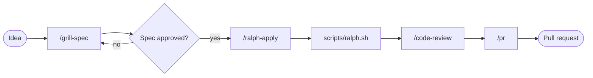

<p align="center">
  
</p>

# dotskills

[](https://github.com/Kaygijzen/dotskills/actions/workflows/validate.yml)

My personal Claude Code setup, versioned like dotfiles: [skills](https://code.claude.com/docs/en/skills) grouped by domain, subagents, hooks, optional MCP configs, and shared conventions in `AGENTS.md`.

New here? Start with the [setup guide](docs/setup.md), then read [model selection](docs/model-selection.md) and [best practices](docs/best-practices.md).

## Quick start

Pick **one** install path per machine.

**Clone and symlink** (macOS, Linux, WSL). Skill names have no prefix (`/grill-spec`) and you get a working copy to edit:

```bash
git clone https://github.com/Kaygijzen/dotskills.git
cd dotskills
./install.sh                # every domain, or: --domain engineering
./install.sh --conventions  # optional: add my conventions to ~/.claude/CLAUDE.md
```

**Or install as a plugin**, no clone needed. Run in a Claude Code session:

```
/plugin marketplace add Kaygijzen/dotskills
/plugin install dotskills@dotskills
```

Plugin skills are namespaced (`/dotskills:grill-spec`). Update with `/plugin marketplace update dotskills`.

Windows, the optional OpenSpec and rtk installs, and every other flag are in the [install reference](docs/install-reference.md). Only the plugin ships hooks (including the secret-file blocker) and MCP configs; only `install.sh --conventions` adds conventions.

## Skills

<!-- skills-table:start (generated by scripts/update-readme.sh from SKILL.md frontmatter; do not edit by hand) -->
<details>
<summary><strong>core</strong> (1)</summary>

| Skill | What it does | Trigger |
| --- | --- | --- |
| `hello-skill` | Greets the user and confirms the dotskills setup is working. | `/hello-skill`, or automatically when the user says "hello skill", asks to test their dotskills install, or invokes /hello-skill. |

</details>

<details>
<summary><strong>engineering</strong> (17)</summary>

| Skill | What it does | Trigger |
| --- | --- | --- |
| `code-review` | Review the changes since a fixed point (commit, branch, tag, or merge-base) along two axes: Standards (does the code follow this repo's documented coding standards?) and Spec (does the code match what the originating issue/spec asked for?). | `/code-review`, or automatically when Runs both reviews in parallel sub-agents and reports them side by side. Use when the user wants to review a branch, a PR, work-in-progress changes, or asks to \"review since X\". |
| `codebase-design` | Shared vocabulary for designing deep modules. | `/codebase-design`, or automatically when the user wants to design or improve a module's interface, find deepening opportunities, decide where a seam goes, make code more testable or AI-navigable, or when another skill needs the deep-module vocabulary. |
| `domain-modeling` | Build and sharpen a project's domain model. | `/domain-modeling`, or automatically when discussing codebase terminology, writing or editing a GLOSSARY.md, or recording or editing an ADR. |
| `grill-spec` | Grill the user until intent is shared, then generate a complete OpenSpec change (proposal, delta specs, design, tasks) and review it with fresh-context sub-agents before handing it to a coding agent. | `/grill-spec` only (never auto-invoked) |
| `implement` | Implement a piece of work based on a spec or set of tickets. | `/implement` only (never auto-invoked) |
| `improve-codebase-architecture` | Scan a codebase for deepening opportunities, present them as a visual HTML report, then grill through whichever one you pick. | `/improve-codebase-architecture` only (never auto-invoked) |
| `pr` | Use when writing a PR body. | `/pr`, or automatically when relevant |
| `prototype` | Build a throwaway prototype to answer a design question. | `/prototype`, or automatically when the user wants to sanity-check whether a state model or logic feels right, or explore what a UI should look like. |
| `ralph-apply` | Apply an approved OpenSpec change with a Ralph loop - a bash loop that runs a fresh headless Claude session per task, so context never piles up. | `/ralph-apply` only (never auto-invoked) |
| `research` | Investigate a question against high-trust primary sources and capture the findings as a Markdown file in the repo. | `/research`, or automatically when the user wants a topic researched, docs or API facts gathered, or reading legwork delegated to a background agent. |
| `retro` | Conduct a retrospective on a coding session. | `/retro` only (never auto-invoked) |
| `setup-dotskills` | Configure this repo for dotskills' engineering skills: set up its issue tracker, triage label vocabulary, and domain doc layout. | `/setup-dotskills` only (never auto-invoked) |
| `tdd` | Test-driven development. | `/tdd`, or automatically when the user wants to build features or fix bugs test-first, mentions "red-green-refactor", or wants integration tests. |
| `to-spec` | Turn the current conversation into a spec and publish it to the project issue tracker: no interview, just synthesis of what you've already discussed. | `/to-spec` only (never auto-invoked) |
| `to-tickets` | Break a plan, spec, or the current conversation into a set of tracer-bullet tickets, each declaring its blocking edges, published to the configured tracker (edges as text in one file per ticket locally, or native blocking links on a real tracker). | `/to-tickets` only (never auto-invoked) |
| `wayfinder` | Plan a huge chunk of work (more than one agent session can hold) as a shared map of decision tickets on your issue tracker, and resolve them one at a time until the way to the destination is clear. | `/wayfinder` only (never auto-invoked) |
| `wizard` | Generate an interactive bash wizard that walks a human through steps only they can perform. | `/wizard`, or automatically when provisioning infrastructure, setting up credentials or CI secrets, walking an unfamiliar third-party dashboard, or running a one-off migration or cutover. Don't invoke this for steps the agent can perform itself. |

</details>

<details>
<summary><strong>productivity</strong> (5)</summary>

| Skill | What it does | Trigger |
| --- | --- | --- |
| `grill-me` | A relentless interview to sharpen a plan or design. | `/grill-me` only (never auto-invoked) |
| `grilling` | Grill the user relentlessly about a plan, decision, or idea. | `/grilling`, or automatically when the user wants to stress-test their thinking, or uses any 'grill' trigger phrases. |
| `handoff` | Compact the current conversation into a handoff document for another agent to pick up. | `/handoff` only (never auto-invoked) |
| `teach` | Teach the user a new skill or concept, within this workspace. | `/teach` only (never auto-invoked) |
| `writing-for-agents` | Writing documents for agents. | `/writing-for-agents`, or automatically when creating or editing skills, or modifying AGENTS.md or CLAUDE.md. |

</details>

<!-- skills-table:end -->

### Subagents

<!-- agents-table:start (generated by scripts/update-readme.sh from agent frontmatter; do not edit by hand) -->
| Agent | Domain | What it does | Model | Tools |
| --- | --- | --- | --- | --- |
| `code-reviewer` | core | Read-only code reviewer | opus | Read, Grep, Glob, Bash |
<!-- agents-table:end -->

Subagents are Claude-only for now; Codex has no equivalent wired up yet.

### Requirements for `grill-spec` and `ralph-apply`

Most skills work out of the box. These two need [OpenSpec](https://github.com/Fission-AI/OpenSpec):

- The `openspec` CLI on your `PATH`. If it's missing, the installer offers to run `npm install -g @fission-ai/openspec@latest`. Pass `--with-openspec` (`-WithOpenSpec` on Windows) to skip the prompt and install, or `--no-openspec` (`-NoOpenSpec`) to skip the question.
- `openspec init` run in the project you're specifying. It creates `openspec/` and installs the `openspec-explore` and `openspec-propose` skills that `grill-spec` invokes.

`ralph-apply` also needs:

- The `claude` CLI on your `PATH`, since the loop runs `claude -p` once per task.
- An approved change on its own branch or worktree. The script refuses to run on `main` or `master`.
- A terminal for the loop itself. `/ralph-apply <change>` checks the change and prints the exact `scripts/ralph.sh` command to run.

### Models used by these skills

`grill-spec` and `ralph-apply` pick a model per task instead of using one for everything:

| Task | Model |
| --- | --- |
| `grill-spec` fact-finder sub-agents | `sonnet` |
| `grill-spec` spec reviewers | `opus` |
| `ralph-apply` loop iterations | `sonnet`; set `RALPH_MODEL` to override |
| The grilling conversation itself | your session model |

`ralph.sh` passes `--model` to `claude -p`, so the loop model is always enforced. The `grill-spec` models are instructions to Claude, which sets `model` on each sub-agent call.

## How I work

Two tools shape this setup:

- **Spec-driven development with [OpenSpec](https://github.com/Fission-AI/OpenSpec).** Before any code, intent is pinned down in a spec (proposal, delta specs, design, tasks) that lives in the repo. `/grill-spec` produces it, `/ralph-apply` implements it task by task, and `/code-review` checks the result against it. The spec, not the chat history, is the source of truth. See [Requirements](#requirements-for-grill-spec-and-ralph-apply) for setup.
- **[rtk](https://github.com/rtk-ai/rtk) to cut token usage.** rtk is a single Rust binary plus a Claude Code `PreToolUse` hook. The hook rewrites Bash commands such as `git status`, `git diff` and test runs to `rtk` equivalents that filter, group and truncate the output before Claude reads it; the project reports 60-90% less output on common dev commands. It only touches Bash tool calls, not the built-in `Read`, `Grep` and `Glob` tools, and it trims Bash output only, so the saving on your total bill is smaller than that. `./install.sh` offers to install it and run `rtk init -g` (`--with-rtk` or `--no-rtk` skips the prompt), and `rtk gain` shows what it has saved. It is optional; nothing in this repo depends on it. The [install reference](docs/install-reference.md) has the details.

## Example flow

One way to chain the skills for a feature too big for a single prompt, following the spec-driven approach above. Step details are in [docs/diagrams/example-flow.md](docs/diagrams/example-flow.md).



## Repo layout

```
dotskills/
├── AGENTS.md  CLAUDE.md          how to work on this repo (CLAUDE.md is @AGENTS.md)
├── docs/                         setup, model selection, best practices
├── conventions/                  my working conventions + project-template/
├── skills/<domain>/<name>/       SKILL.md plus scripts/ and references/
├── agents/<domain>/<name>.md     subagents
├── hooks/<domain>/               hooks.json + scripts/ (plugin installs only)
├── mcp/<domain>/.mcp.json        optional MCP configs (env vars only)
├── install.sh  install.ps1       symlink installers
├── scripts/                      validate, update-readme, sync-plugin, new-skill, ci
├── templates/SKILL.md
├── .claude-plugin/               one marketplace and one plugin, both "dotskills"
└── .github/workflows/validate.yml  runs scripts/ci.sh
```

Domains organise the repo and decide what `install.sh` links. They are not separate plugins: there is one plugin, `dotskills`, containing every domain. If others ever want only some domains, per-domain plugins can be added next to it without moving files.

## How it works

`install.sh` symlinks each `skills/<domain>/<name>` folder into `~/.claude/skills/` and each agent into `~/.claude/agents/`. Claude Code reads the files straight from this repo, so an edit takes effect without a copy step.

`plugin.json` lists every domain folder under `skills`, every agent file under `agents` (the schema takes files, not folders), and the hook files, so both install methods use the same files. `scripts/sync-plugin.sh` regenerates those lists and `validate.sh` fails if they drift.

`plugin.json` has no `version`, so plugin installs track the latest commit. To pull changes on another machine, run `/plugin marketplace update dotskills`. `claude plugin validate .` warns about the missing version, about the root `CLAUDE.md` not being plugin context, and (with the directory profile) about a missing icon. Those warnings are expected.

## Conventions

Write conventions once in `AGENTS.md`; Claude reads them through a `CLAUDE.md` containing `@AGENTS.md`, and Codex reads `AGENTS.md` natively.

- **This repo:** `AGENTS.md` at the root.
- **Your machines:** `./install.sh --conventions` adds an import of `conventions/AGENTS.md` to `~/.claude/CLAUDE.md` inside a marked block (`# >>> dotskills conventions >>>`). `--uninstall` removes only that block.
- **A project:** `./install.sh --init-project <path>` copies `conventions/project-template/` without overwriting anything.

## Contributing and reference

- [Contributing](docs/contributing.md): adding a skill, a domain, subagents, hooks and MCP configs, and [updating imported skills](docs/contributing.md#updating-imported-skills).
- [Install reference](docs/install-reference.md): every `install.sh` flag, Windows differences, name conflicts.
- [Troubleshooting](docs/troubleshooting.md)

Short version for a new skill: `scripts/new-skill.sh <domain> <name>`, then `scripts/update-readme.sh && scripts/sync-plugin.sh && scripts/ci.sh`.

## Credits

- Skills imported from [mattpocock/skills](https://github.com/mattpocock/skills) (MIT). See `upstream.json` and `THIRD_PARTY_NOTICES.md`. `pr` credits Dex Horthy's [`show-me`](https://github.com/humanlayer/skills/blob/main/plugins/show-me/skills/show-me/SKILL.md) in its own `CREDITS.md`.
- Coding principles in the conventions are condensed from [andrej-karpathy-skills](https://github.com/multica-ai/andrej-karpathy-skills) (MIT per its skill frontmatter); the full text is in `docs/karpathy-guidelines.md`.
