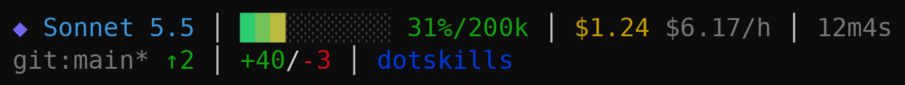
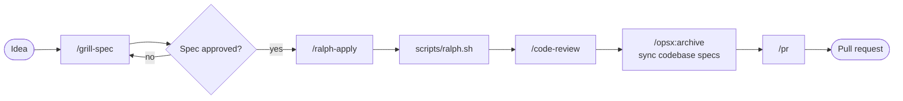

<p align="center">
  
</p>

# dotskills

[](https://github.com/Kaygijzen/dotskills/actions/workflows/validate.yml)

My personal Claude Code setup, versioned like dotfiles. Fork it or take what you want. It holds [skills](https://code.claude.com/docs/en/skills) grouped by domain, subagents, hooks, and shared conventions.

## What's in it

### Conventions

Short working rules for every project, in [`conventions/AGENTS.md`](conventions/AGENTS.md). Four coding principles: think before coding, simplicity first, surgical changes, goal-driven execution. Plus git rules (small commits, work on a branch, ask before destructive operations), safety rules (no secrets or client data anywhere) and quality rules (tests with every behaviour change, run the checks before calling work done).

### Statusline

The statusline is the bar Claude Code draws below the input box, filled by a script that reruns as the session changes. Ours shows the model, a context-use bar, cost and spend rate, session time, rate limits, git branch with ahead/behind upstream, and the worktree the session is in.



### Skills

Skills are instruction sets Claude loads when a task calls for them. Some trigger on their own when your request matches their description; others run only when you type their slash command. They are grouped by domain.

- **core:** checks that the install works and sets up the statusline.
- **engineering:** specifying, building, reviewing and shipping code.
- **productivity:** sharpening plans, getting a second opinion, handing off work and explaining things more simply.

<!-- skills-table:start (generated by scripts/update-readme.sh from SKILL.md frontmatter; do not edit by hand) -->
<details>
<summary><strong>core</strong> (2)</summary>

| Skill | What it does | Trigger |
| --- | --- | --- |
| `hello-skill` | Greets the user and confirms the dotskills setup is working. | `/hello-skill`, or automatically when the user says "hello skill", asks to test their dotskills install, or invokes /hello-skill. |
| `setup-dotskills` | Installs the dotskills statusline, sets the default model to sonnet, and optionally installs the OpenSpec CLI and rtk, for plugin installs that cannot do it themselves. | `/setup-dotskills` only (never auto-invoked) |

</details>

<details>
<summary><strong>engineering</strong> (11)</summary>

| Skill | What it does | Trigger |
| --- | --- | --- |
| `code-review` | Review the changes since a fixed point (commit, branch, tag, or merge-base) along two axes: Standards (does the code follow this repo's documented coding standards?) and Spec (does the code match what the originating issue/spec asked for?). | `/code-review`, or automatically when the user wants to review a branch, a PR, work-in-progress changes, or asks to \"review since X\". |
| `codebase-design` | Shared vocabulary for designing deep modules. | `/codebase-design`, or automatically when the user wants to design or improve a module's interface, find deepening opportunities, decide where a seam goes, make code more testable or AI-navigable, or when another skill needs the deep-module vocabulary. |
| `domain-modeling` | Build and sharpen a project's domain model. | `/domain-modeling`, or automatically when discussing codebase terminology, writing or editing a GLOSSARY.md, or recording or editing an ADR. |
| `grill-spec` | Grill the user until intent is shared, then generate a complete OpenSpec change (proposal, delta specs, design, tasks) and review it with fresh-context sub-agents before handing it to a coding agent. | `/grill-spec` only (never auto-invoked) |
| `improve-codebase-architecture` | Scan a codebase for deepening opportunities, present them as a visual HTML report, then grill through whichever one you pick. | `/improve-codebase-architecture` only (never auto-invoked) |
| `pr` | Write a pull request body. | `/pr`, or automatically when writing a PR body. |
| `prototype` | Build a throwaway prototype to answer a design question. | `/prototype`, or automatically when the user wants to sanity-check whether a state model or logic feels right, or explore what a UI should look like. |
| `ralph-apply` | Apply an approved OpenSpec change with a Ralph loop - a bash loop that runs a fresh headless Claude session per task, so context never piles up. | `/ralph-apply` only (never auto-invoked) |
| `research` | Investigate a question against high-trust primary sources and capture the findings as a Markdown file in the repo. | `/research`, or automatically when the user wants a topic researched, docs or API facts gathered, or reading legwork delegated to a background agent. |
| `retro` | Conduct a retrospective on a coding session. | `/retro` only (never auto-invoked) |
| `wizard` | Generate an interactive bash wizard that walks a human through steps only they can perform. | `/wizard`, or automatically when provisioning infrastructure, setting up credentials or CI secrets, walking an unfamiliar third-party dashboard, or running a one-off migration or cutover. Don't invoke this for steps the agent can perform itself. |

</details>

<details>
<summary><strong>productivity</strong> (7)</summary>

| Skill | What it does | Trigger |
| --- | --- | --- |
| `bro` | Re-explain the previous assistant message, or any text typed after the command, in a much simpler way. | `/bro` only (never auto-invoked) |
| `grill-me` | A relentless interview to sharpen a plan or design. | `/grill-me` only (never auto-invoked) |
| `grilling` | Grill the user relentlessly about a plan, decision, or idea. | `/grilling`, or automatically when the user wants to stress-test their thinking, or uses any 'grill' trigger phrases. |
| `handoff` | Compact the current conversation into a handoff document for another agent to pick up. | `/handoff` only (never auto-invoked) |
| `second-opinion` | Get a second opinion from Opus on the hard question in this conversation; assembles the briefing from context and relays the answer. | `/second-opinion` only (never auto-invoked) |
| `teach` | Teach the user a new skill or concept, within this workspace. | `/teach` only (never auto-invoked) |
| `writing-for-agents` | Writing documents for agents. | `/writing-for-agents`, or automatically when creating or editing skills, or modifying AGENTS.md or CLAUDE.md. |

</details>

<!-- skills-table:end -->

### Subagents

<!-- agents-table:start (generated by scripts/update-readme.sh from agent frontmatter; do not edit by hand) -->
| Agent | Domain | What it does | Model | Tools |
| --- | --- | --- | --- | --- |
| `code-reviewer` | engineering | Read-only code reviewer | opus | Read, Grep, Glob, Bash |
| `ask-opus` | productivity | Second opinion from Opus on one hard question, with small, guided research | opus | Read, Grep, Glob |
<!-- agents-table:end -->

Subagents are Claude-only for now; Codex has no equivalent wired up yet.

### Hooks

A secret blocker stops Claude from reading or editing `.env*`, keys and similar files. Hooks ship only with the plugin install.

## Getting started

Just want to use the skills? Install the plugin. Want to edit them? Clone and symlink. Pick one per machine.

**Install as a plugin**, no clone needed. Run in a Claude Code session:

```
/plugin marketplace add Kaygijzen/dotskills
/plugin install dotskills@dotskills
```

Then run `/dotskills:setup-dotskills` once, also inside a Claude Code session. Plugins can't change settings or install tools, so this skill installs the statusline, sets the default model to sonnet if none is set, and offers to install OpenSpec (for `/grill-spec` and `/ralph-apply`) and rtk. Run it again after each plugin update.

**Or clone and symlink** (macOS, Linux, WSL):

```bash
git clone https://github.com/Kaygijzen/dotskills.git
cd dotskills
./install.sh                # every domain, or: --domain engineering
./install.sh --conventions  # optional: add my conventions to ~/.claude/CLAUDE.md
```

Run `/hello-skill` (or `/dotskills:hello-skill`) to check it works.

The [setup guide](docs/setup.md) has the full walkthrough: conventions, statusline, updating and per-project setup. The [install reference](docs/install-reference.md) has every flag, Windows, OpenSpec and rtk. Stuck? See [troubleshooting](docs/troubleshooting.md).

## How I use it

When requirements live only in chat history, AI-written code is unpredictable. [OpenSpec](https://github.com/Fission-AI/OpenSpec) keeps the agreed *what* in plain Markdown in the repo, so the spec, not the chat, is what the agent implements and a reviewer checks against. `/grill-spec` and `/ralph-apply` replace the propose and apply steps for large or fuzzy changes. The `/opsx:*` commands come from OpenSpec: `openspec init` installs them, not dotskills.

For a feature too big for a single prompt, I chain the skills like this. Step details are in [docs/diagrams/example-flow.md](docs/diagrams/example-flow.md).



The full loop and folder layout are in [best practices](docs/best-practices.md#1-spec-driven-development). What `grill-spec` and `ralph-apply` need is in [Requirements](docs/best-practices.md#requirements).

## Docs

- [Setup](docs/setup.md): install Claude Code and dotskills, conventions, statusline, settings, updating.
- [Install reference](docs/install-reference.md): every installer flag, Windows, OpenSpec, rtk, name conflicts.
- [Model selection](docs/model-selection.md): when to use Sonnet, Opus or Haiku.
- [Best practices](docs/best-practices.md): spec-driven development, context management, habits.
- [Contributing](docs/contributing.md): repo layout, adding skills and domains, hooks, imported skills.
- [Troubleshooting](docs/troubleshooting.md): common install and runtime problems.

## Credits

- Skills imported from [mattpocock/skills](https://github.com/mattpocock/skills) (MIT). See `upstream.json` and `THIRD_PARTY_NOTICES.md`. `pr` credits Dex Horthy's [`show-me`](https://github.com/humanlayer/skills/blob/main/plugins/show-me/skills/show-me/SKILL.md) in its own `CREDITS.md`.
- `bro` is imported from [luchasarie/bro-skill](https://github.com/luchasarie/bro-skill) (MIT). Licence kept in `skills/productivity/bro/LICENSE`; see `upstream.json` and `THIRD_PARTY_NOTICES.md`.
- Coding principles in the conventions are condensed from [andrej-karpathy-skills](https://github.com/multica-ai/andrej-karpathy-skills) (MIT per its skill frontmatter); the full text is in `docs/karpathy-guidelines.md`.
