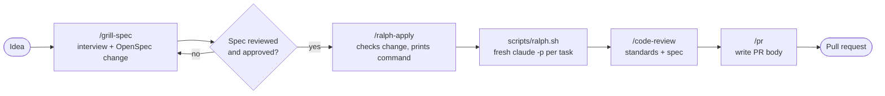

# Example flow: from idea to pull request

One way to chain the skills for a feature that is too big for a single prompt.

| Step | Skill | Model | Where it runs |
| --- | --- | --- | --- |
| 1 | `grill-spec` | session model, `sonnet` fact-finders, `opus` reviewers | Claude Code session |
| 2 | `ralph-apply` | `sonnet` (override with `RALPH_MODEL`) | Terminal, on a non-`main` branch or worktree |
| 3 | `code-review` | session model | Claude Code session |
| 4 | `pr` | session model | Claude Code session |

For smaller work, swap steps 1-2 for `/to-spec`, `/to-tickets` and `/implement`.
