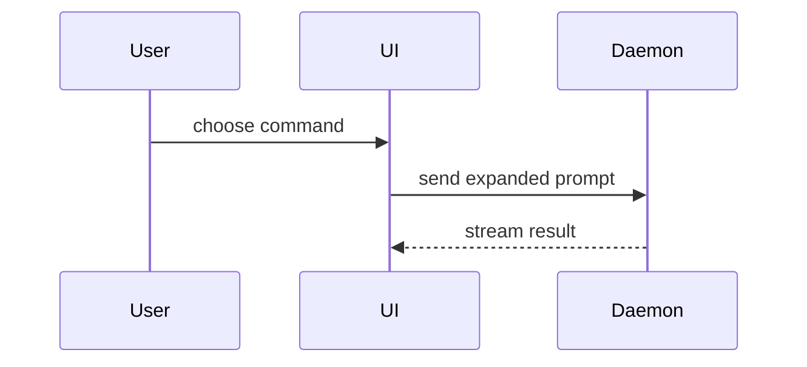

Use this template for writing the PR body:

```markdown
## Summary

<diagram, diff-sketch, or tree>

## Evidence

- **Before:** <screenshot/output/failing test run>
  **After:** <screenshot/output/passing test run>

## Merge Danger

**Risk:** <Low, Medium or High>

**Undo:** <the concrete steps to roll this back, and anything a revert does not restore>

**Effect:** <what the merge changes outside the diff (systems, consumers, data, infrastructure) and when; and who is hit if it is wrong: one page or feature, all users, or other teams and external callers>
```

## Sections

Skip all preambles and keep prose brief. Use the user's domain language from `GLOSSARY.md`.

### Summary

Pick the smallest view that makes the key point clear.

- Show logic or an algorithm as pseudocode:

```text
on(save)
  if content is unchanged
    return cached result
  write new content
  return fresh result
```

- Show runtime control flow as a call tree:

```text
submitForm
  createSession
    persistPrompt
    launchAgent
  navigateToSession
```

- Show UI structure as a component tree, including state and module boundaries that matter:

```text
<SessionPage> (apps/example/src/routes/session.tsx)
  useSessionEvents()
  <SessionToolbar>
    <RunSkillButton> (packages/ui)
```

- Show file responsibility or a broad refactor as a shallow file tree:

```text
src/
├── commands/       # parses user actions
├── sessions/       # owns session state
└── transport/      # sends API requests
```

- Show component interaction, control flow, or data flow with Mermaid:



- Use `diff` when the point is what changes and the surrounding shape already exists. Match the diff shape to the topic.

For a component change:

```diff
 <SessionPage>
   useSessionEvents()
   <SessionToolbar>
+    <RunSkillButton />
   <SessionTimeline>
+    <SkillResultCard />
```

For a file-layout change:

```diff
 src/
 ├── commands/
+│   └── show-me.ts       # expands the slash command
 ├── sessions/
-└── transport.ts
+└── transport/
+    ├── client.ts
+    └── stream.ts
```

For a call-tree or call-stack change:

```diff
 submitForm
   createSession
     persistPrompt
+    expandSkillMention
     launchAgent
-  navigateToSession
+  navigateToSession
+    subscribeToEvents
```

For a state or control-flow change:

```diff
 on(save)
-  write content
+  if content is unchanged
+    return cached result
+  write new content
+  invalidate cache
```

- Show the whole block when most of it is new, when omitted context would hide ownership or order, or when the user needs a copyable target shape:

```ts
function expandSkill(command: string): string {
  const skillName = command.slice(1);
  return `use the ${skillName} skill`;
}
```

#### Guidance

Place each visual next to the short text it supports. Keep only the calls, files, props, states, and boundaries needed to answer the user's current question or the options to resolve the current discussion point.

You may use one of these, you may use several, it is unlikely you will use all of them. Use your judgement and don't overwhelm the user.

### Evidence

Concrete evidence that the change works. Show a before and after.

Screenshots are S-tier - when the environment is set up for it and the change is visual.

Execution-based evidence is A-tier. Test results, console output. Show the exact test that now fails and passes, using pseudocode.

### Merge Danger

Say how risky the merge is, how to undo it, and what it affects. Write the undo as concrete steps, not a metaphor: a reviewer should see from it what rolling back costs.

Pick **Risk** with these criteria so the level means the same on every PR:

| Level | Criteria |
|---|---|
| Low | Reverting the PR fully undoes it, no data, contract or infrastructure state changes, and a failure stays within the changed feature |
| Medium | Reverting works but needs an extra step (an infrastructure apply, a redeploy, a config change), or a failure would reach all users, other teams or external callers |
| High | Reverting does not fully undo it: data migrations, deleted resources, ids or contracts that other systems store or depend on |

For **Effect**, consider everything the change can reach: consumers of an API or contract, deployed infrastructure, stored data, layout or mobile responsiveness for UI changes. Say "no runtime behaviour changes" when that is true. End with the reach of a failure: name who would notice if this breaks.

Example:

```markdown
**Risk:** Medium

**Undo:** Revert the PR and run the terraform pipeline. No data or state to restore.

**Effect:** Updates the APIM API definition on the next `terraform apply` (response definitions and descriptions only). No runtime behaviour changes; if wrong, only the published API docs are affected.
```
